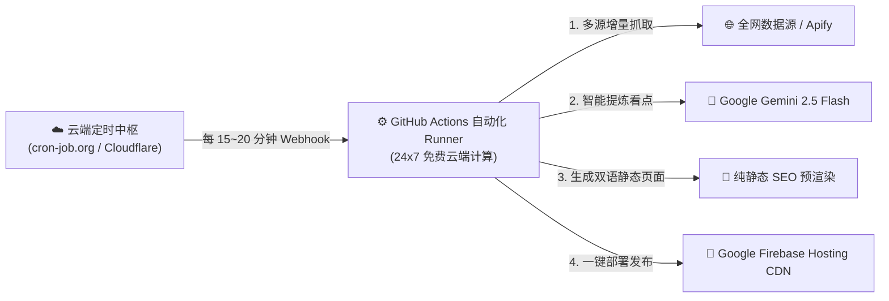

# ☁️ 100% 纯云端脱机自动化部署指南 ($0 成本)

本指南旨在**彻底脱离本地电脑与个人环境**，实现全天候 24×7 真正每 15~20 分钟全自动抓取、Gemini AI 摘要、预渲染并自动发布到 Firebase Hosting。

---

## 🏗️ 全云端无服务器架构拓扑



> **核心原则**：
> 1. 本地电脑随时关机、休眠、断网，不影响任何自动化运行。
> 2. 算力、存储、CDN、触发源全部运行在顶级云厂商（GitHub / Google Cloud / Cloudflare）的免费 Serverless 基础设施上。

---

## 方案一：使用 cron-job.org 免费云端 Webhook（最推荐，2分钟搞定，零代码）

`cron-job.org` 是一个运营超过 10 年的全球免费云端定时器平台，服务器位于德国云数据中心，永久免费且每分钟精度极高。

### 步骤 1：获取 GitHub 个人访问令牌 (PAT)
1. 打开 GitHub 网页右上角头像 -> **Settings** -> 最底部 **Developer Settings** -> **Personal access tokens** -> **Tokens (classic)**。
2. 点击 **Generate new token (classic)**：
   - **Note**: `ai-radar-cron`
   - **Expiration**: `No expiration`（永不过期）
   - **Scopes（权限）**: 勾选 `repo`（完整代码仓库控制权限）与 `workflow`。
3. 点击底部生成，**复制生成的令牌字符串**（以 `ghp_` 开头，仅显示一次）。

### 步骤 2：在 cron-job.org 添加定时任务
1. 打开 [https://cron-job.org](https://cron-job.org) 并注册/登录免费账号。
2. 点击 **Create Cronjob**：
   - **Title**: `AI Radar 20-Min Auto Deploy`
   - **URL**: `https://api.github.com/repos/AInextday-ctrl/ai-news-radar/dispatches`
   - **Schedule**: 选择 `Every 20 minutes`（或 `Every 15 minutes`）
   - **Request method**: 选择 `POST`
3. 展开 **Advanced** 设置：
   - **Headers**（添加 3 个请求头）：
     - `Authorization`: `Bearer ghp_您的GitHubToken`
     - `Accept`: `application/vnd.github.v3+json`
     - `User-Agent`: `CronJob-Cloud-Dispatcher`
   - **Request Body**（请求体）：
     ```json
     {"event_type": "auto-sync"}
     ```
4. 点击 **Save**（保存）。

> 🏆 **完成**！从保存的这一刻起，cron-job.org 将在云端每 20 分钟精准向 GitHub 发起一次信号，GitHub Actions 会在 5 秒内启动并自动部署至 Firebase Hosting，您的本地电脑可以彻底关机！

---

## 方案二：使用 Cloudflare Workers 边缘函数（Serverless 极客方案）

如果您已有 Cloudflare 账号，可直接使用本项目提供的 `cloudflare_worker.js`：

1. 打开 Cloudflare 控制台 -> **Compute (Workers) -> Workers & Pages** -> **Create application** -> **Create Worker**。
2. 将 `cloud_automation/cloudflare_worker.js` 的完整代码粘贴并点击 **Deploy**。
3. 进入 Worker 的 **Settings** -> **Variables and Secrets**：
   - 添加环境变量密钥：`GITHUB_PAT` = 您的 GitHub Token（加密保存）。
4. 进入 Worker 的 **Settings** -> **Triggers** -> **Cron Triggers**：
   - 点击 **Add Cron Trigger**，填入：`*/20 * * * *`（每 20 分钟）或 `*/15 * * * *`（每 15 分钟）。
5. 保存即可。Cloudflare 全球边缘节点将全天候自动调度。
