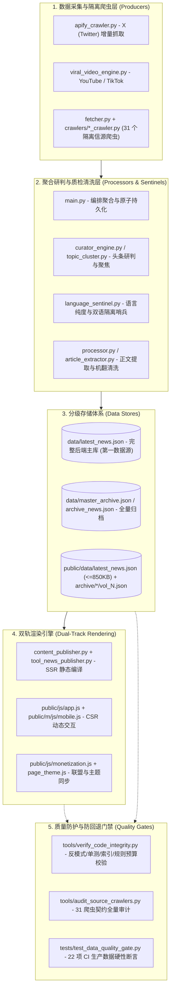

# AI News Radar 核心架构、数据契约与符号依赖索引 (Architecture & Data Contract Index)

> **版本**：v5.0  
> **适用范围**：AI News Radar 全栈系统（采集、31 信源隔离爬虫、研判清洗、SSR/CSR 双轨渲染、CI 22 项硬门禁）  
> **关联索引**：自动化符号与全量信源注册表见 [`tools/CODEBASE_INDEX.md`](../tools/CODEBASE_INDEX.md)；全局与目录守则见 [`AGENTS.md`](../AGENTS.md)、[`crawlers/AGENTS.md`](../crawlers/AGENTS.md)、[`public/AGENTS.md`](../public/AGENTS.md)

---

## 一、 系统架构分层与数据流向图



---

## 二、 核心数据模型契约 (Data Contracts)

严禁在任何模块中绕过字段契约，更严禁在抓取失败或缺失字段时使用“静默伪造默认值”（如 `datetime.now()` 冒充发布时间或 `diff_hours: 12.0`）。

### 1. 视频实体契约 (`category: "videos"`)

| 字段名 | 类型 | 严格约束与业务定义 |
| :--- | :--- | :--- |
| `id` | `str` | 视频唯一哈希（如 `yt_dQw4w9WgXcQ` 或 md5） |
| `published` | `str` | YouTube / Web 原始展示时间（如 `14h ago`, `1y ago`, `8 months ago`） |
| `raw_published_at` | `str (ISO 8601)` | **真实 UTC 发布时间**。须由 `parse_relative_time_info()` 严格解析，**严禁直接赋为当前抓取时间 `now()`** |
| `diff_hours` | `float` | 距当前时间的真实发布间隔小时数；历史视频必须 `> 48.0` |
| `is_recent_24h` | `bool` | 仅 `diff_hours <= 24.0` 且非历史标记时为 `True` |
| `is_recent_48h` | `bool` | 仅 `diff_hours <= 48.0` 且非历史标记时为 `True` |
| `surge_badge` | `str` | 历史视频严禁出现 `24h飙升`，必须降级为 `实战精讲` 或 `精选教学` |
| `title_zh` | `str` | 历史视频严禁出现 `【48h 极客实测】` 前缀，必须使用 `【实战精讲】` |
| `url` / `author` | `str` | 视频直达播放链接 / 频道创作者名称 |

### 2. 快讯实体契约 (`category: "news"`)

- 必含字段：`title_en`, `title_zh`, `summary_en`, `summary_zh`, `fact_bullets_en`, `fact_bullets_zh`, `paragraphs`, `paragraphs_zh`, `cover_image`
- 约束：`fact_bullets_zh` ≥ 3 条增量事实，零万金油套话；正文零配图注释/摄影署名/付费墙试读/异源通讯社前缀；英文页与 `_en` 字段零中文字符；配图优先本地 `/images/...`，缺省仅回退 `/images/og-default.jpg`。

### 3. 大V发言实体契约 (`category: "celebrity"`)

- 必含字段：`full_text_en`, `full_text_zh`, `author`, `author_handle`, `url`
- 约束：长推文多段落无损保真（保留 `\n\n`，严禁抹平为单行，中英文段落数对齐）。

---

## 三、 跨文件关键符号与调用索引表 (Symbol Cross-Reference)

修改任意模块前，先通过 `python tools/fast_index.py symbol <name>` 定位精确行号，并核查下表中的所有上下游消费端：

| 核心功能 / 业务域 | 生产 / 计算端 (Producer) | 服务端静态渲染 (SSR) | 客户端动态渲染 (CSR) | 门禁与测试 (CI Gate) |
| :--- | :--- | :--- | :--- | :--- |
| **31 权威信源定向抓取** | `crawlers/*_crawler.py` (`crawl_*`, `is_*_url`) | `tool_news_publisher.py` | `public/js/app.js` (`openAiNewsModal`) | `tools/audit_source_crawlers.py`<br>`tests/test_data_quality_gate.py` (断言 19, 20, 21) |
| **视频时间解析与防伪** | `viral_video_engine.py`: `parse_relative_time_info()` | `content_publisher.py`: `format_static_video_card()` | `public/js/app.js`: `formatVideoTime()` | `tests/test_video_pipeline.py`<br>`tests/test_data_quality_gate.py` (断言 4, 18) |
| **中英文纯度与语言隔离** | `language_sentinel.py`: `sanitize_item_language()` | `content_publisher.py` + `tool_news_publisher.py` | `public/js/app.js` + `page_language.js` | `tests/test_data_quality_gate.py` (断言 1, 8) |
| **后端主库与前端分卷** | `main.py` + `scripts/export_archive_volumes.py` | **必须读取 `data/latest_news.json` 与 `data/master_archive.json`** | `public/js/app.js` 读取 `public/data/latest_news.json` + `vol_N.json` | `tests/test_data_quality_gate.py` (断言 14, 20) |
| **推文多段落高保真** | `apify_crawler.py`: `fetch_incremental_tweets()` | `content_publisher.py` 保留 `\n\n` | `public/js/app.js` 弹窗多段渲染 | `tests/test_data_quality_gate.py` (断言 5, 10, 11, 12) |
| **联盟好物与明暗主题** | `tools/build_affiliate_catalog.py` + `fetch_affiliate_images.py` | `tool_news_publisher.py` (`build_theme_toggle_html`) | `public/js/monetization.js` + `page_theme.js` | `tests/test_data_quality_gate.py` (断言 17, 22) |
| **上线同步与配额治理** | `tools/safe_sync.py` + `tools/prune_firebase_versions.py` | `.github/workflows/update_and_deploy.yml` | Firebase Hosting (`firebase.json`) | `tests/test_data_quality_gate.py` (断言 15, 22) |

---

## 四、 双轨渲染同构与零割裂守则 (SSR vs CSR)

1. **后端主库第一数据源**：`content_publisher.py` 与 `tool_news_publisher.py` 必须以 `data/latest_news.json` / `data/master_archive.json` 为第一数据源，严禁读取前端裁剪版 `public/data/latest_news.json`。
2. **渲染规则与水合时间戳同步**：修改卡片/时间渲染逻辑须同步对齐 `content_publisher.py`、`public/js/app.js` 与 `public/m/js/mobile.js`；前端复用 SSR DOM 前必须强校验 `updated_at` 时间戳。
3. **发布必重编译与双门禁**：
   ```bash
   python tool_news_publisher.py
   python content_publisher.py
   python tools/verify_code_integrity.py
   python tests/test_data_quality_gate.py
   ```

---

## 五、 代码修改与防回退操作规范 (Engineering Change Protocol)

1. **极速检索定位**：优先运行 `python tools/fast_index.py symbol/source/search/data/rules`，禁止对 `data/*.json` 执行慢扫描。
2. **目录作用域合规**：改动 `crawlers/` 时核对 `crawlers/AGENTS.md`，改动 `public/` 时核对 `public/AGENTS.md`。
3. **三级防回退验证**：干净子进程导包 -> 下游发布器实跑 -> `verify_code_integrity.py`（含索引自动同步 + 规则 24 KB 预算校验）+ `test_data_quality_gate.py`（22 项断言）。
4. **安全推送与双端实测**：使用 `python tools/safe_sync.py` 同步推送，并对 `https://ainewsradar.xyz` 与 `https://ai-radar-news.web.app` 现场抓包验收。
